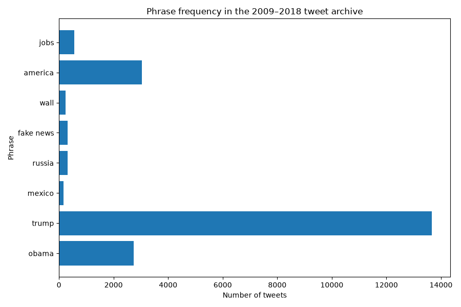

# [lab-web-data](https://csci40.rtealwitter.com/topics/05_web_scraping/lab.html)

This analysis searches 35,402 tweet records from 2009–2018, ignoring capitalization and counting each record once per phrase.

Among the three catalog phrases, America was predicted to appear most often. The results support that prediction: America appeared in 3,038 records, compared with 562 for jobs and 242 for wall. Trump was the most frequent phrase overall.

|            phrase | percent of tweets |
| ----------------: | ----------------- |
|             obama | 07.73             |
|             trump | 38.58             |
|            mexico | 00.45             |
|            russia | 00.91             |
|         fake news | 00.88             |
|              wall | 00.68             |
|           america | 08.58             |
|              jobs | 01.59             |

A tweet can contain multiple phrases, so these percentages do not have to add up to 100%. These results describe the archive, not merchandise sales or public opinion.